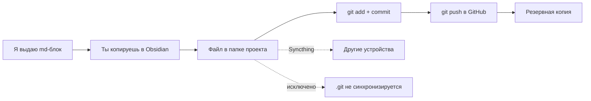

# Алгоритм сохранения партий «Киберзащитник»

> [!abstract] Кратко
> Проект живёт в папке `~/ObsidianVault/Проекты/Киберзащитник/` внутри личного хранилища. У папки свой `.git`, Syncthing его игнорирует через `.stignore`. Партии сохраняются через Obsidian (`Ctrl+N` → `Ctrl+V` → `Ctrl+S`), затем коммит и push в GitHub через терминал. 30 секунд на партию. Передача между чатами — через `_Состояние_Проекта.md`.

## 1. Зачем это нужно
Проект «Киберзащитник» (148 заметок) должен быть:
1. **Изолирован** от личного хранилища — чтобы публикация базы не тащила за собой ПТСР-дневники, контекст подопечного и прочее личное.
2. **Под контролем версий** — если что-то сломается, `git log` покажет историю и вернёт.
3. **С резервной копией вне ПК** — GitHub хранит копию, если Syncthing сломает хранилище.
4. **Передаваем между чатами** — `_Состояние_Проекта.md` фиксирует прогресс и правила.

## 2. Простыми словами
- **Личное хранилище** — твой рабочий стол. На нём лежит папка `Проекты/Киберзащитник`.
- **Внутри этой папки** — свой «сейф» (`.git`), который хранит историю изменений.
- **Syncthing** синхронизирует всё, кроме `.git` и `.obsidian` (исключены через `.stignore`).
- **GitHub** — вторая копия сейфа в интернете. Если сгорит ПК, проект выживет.
- **`_Состояние_Проекта.md`** — записка для нового чата, если текущий кончился.
- **Ты** копируешь мои заметки в папку → коммит → push → сохранено в трёх местах (ПК, Syncthing-устройства, GitHub).

## 3. Технические детали

### 3.1 Структура

```text
~/ObsidianVault/                         ← личное хранилище (Syncthing)
├── .stignore                            ← исключает .git из синхронизации
├── Проекты/
│   └── Киберзащитник/                   ← проект (вложенный git)
│       ├── .git/                        ← история (Syncthing игнорирует)
│       ├── .gitignore                   ← что не коммитить
│       ├── README.md
│       ├── _Алгоритм_Сохранения.md      ← этот файл
│       ├── _Состояние_Проекта.md        ← снимок для передачи в новый чат
│       ├── Киберзащитник_MOC.md
│       ├── 30_01_IT/Сети/               ← атомарные заметки
│       └── Конспекты_занятий_неразобранное/
│           ├── NGFW_UserGate/
│           └── Kaspersky_Endpoint/
```

### 3.2 Что уже сделано (по состоянию на 2026-11-16)

| Шаг | Статус |
|---|---|
| Установлен git 2.47.3 | ✅ |
| `git config --global user.name` / `user.email` | ✅ |
| Регистрация на GitHub (qosscrinson) | ✅ |
| Репозиторий `cyber-defender` создан, приватный | ✅ |
| SSH-ключ добавлен в GitHub | ✅ |
| Папка `Проекты/Киберзащитник` создана | ✅ |
| `.stignore` создан (включая строки проекта) | ✅ |
| `git init`, remote указывает на `cyber-defender` | ✅ |
| Первый коммит + push | ✅ |
| Партии 1–7 сохранены (37 файлов) | ✅ |

**Что осталось из настройки:** ничего. Система работает. Дальше — только сохранение партий.

### 3.3 Схема потока



- **Читать схему:** мой md-блок → твой Obsidian → папка проекта → git-коммит → GitHub. Syncthing синхронизирует файлы, но не `.git`.

### 3.4 `.stignore` — что исключаем и почему

Строки в `~/ObsidianVault/.stignore`, относящиеся к проекту:

```text
Проекты/Киберзащитник/.git
Проекты/Киберзащитник/.obsidian/workspace.json
Проекты/Киберзащитник/.obsidian/workspace-mobile.json
Проекты/Киберзащитник/.obsidian/cache
```

**Почему `.git`:** Syncthing синхронизирует файлы, но не умеет мержить `.git`. Конфликт внутри `.git` = сломанный репозиторий. `.git` живёт **только на одном устройстве**.

**Почему `.obsidian/workspace.json`:** состояние открытых вкладок. На разных устройствах разное, синхронизировать нет смысла.

### 3.5 `.gitignore` — что не коммитим

```text
.obsidian/workspace.json
.obsidian/workspace-mobile.json
.obsidian/cache
.obsidian/plugins/*/data.json
.trash/
node_modules/
public/
*.log
.DS_Store
```

**Почему:** служебные файлы Obsidian и мусор. Плагины ставятся заново. `node_modules/` и `public/` — от Quartz (появятся позже).

## 4. Пример / команда

### 4.1 Первый раз — настройка (уже сделано, для справки)

Для истории. Если начнёшь с нуля на другом устройстве:
1. Установить git (`apt install git` / `winget install Git.Git`).
2. `git config --global user.name` / `user.email`.
3. Регистрация на GitHub, репозиторий `cyber-defender` (приватный).
4. `ssh-keygen -t ed25519`, `cat ~/.ssh/id_ed25519.pub` → вставить в GitHub → Settings → SSH keys.
5. `mkdir -p ~/ObsidianVault/Проекты/Киберзащитник && cd ... && git init && git branch -M main && git remote add origin git@github.com:qosscrinson/cyber-defender.git`.
6. `.stignore` в корне хранилища (раздел 3.4).
7. `.gitignore` в проекте (раздел 3.5).
8. Первый коммит: `git add README.md .gitignore && git commit -m "init" && git push -u origin main --force` (force — только первый раз).

### 4.2 Каждый раз — сохранение партии (30 секунд)

**Шаг 1.** Создать папки, если нужно:

```bash
cd ~/ObsidianVault/Проекты/Киберзащитник
mkdir -p 30_01_IT/Сети
mkdir -p Конспекты_занятий_неразобранное/NGFW_UserGate
mkdir -p Конспекты_занятий_неразобранное/Kaspersky_Endpoint
```

**Шаг 2.** Для каждого файла партии:
- `Ctrl+N` → имя файла (без `.md`, например `SVI`)
- `Ctrl+V` → мой md-блок
- `Ctrl+S`
- В Obsidian `Ctrl+P` → **Move file to...** → выбрать папку (`30_01_IT/Сети/`).

**Шаг 3.** Коммит и push:

```bash
cd ~/ObsidianVault/Проекты/Киберзащитник
git add .
git status                # проверь: 5 новых файлов
git commit -m "партия N: <краткий список>"
git push
```

### 4.3 Проверка после партии

```bash
git log --oneline          # история коммитов
git status                 # должно быть "nothing to commit"
find . -name "*.md" | wc -l # сколько файлов всего
```

**Маркер:** после партии 7 — 9 коммитов (init + docs + 7 партий) и 37 md-файлов.

### 4.4 Что делать, если кончился лимит токенов в чате

**Признаки:** ассистент начинает «забывать» начало, путает контекст, выдаёт короче или с ошибками.

**Действия:**
1. В конце текущего чата ассистент выдаёт `_Состояние_Проекта.md` — снимок.
2. Ты сохраняешь его в проект и коммитишь.
3. Открываешь **новый чат**.
4. Первое сообщение: «Продолжаем проект «Киберзащитник». Прочитай `_Алгоритм_Сохранения.md` и `_Состояние_Проекта.md`. Затем выдай партию N+1».
5. Прикладываешь оба файла.
6. Ассистент продолжает с того же места.

**Почему это работает:** `_Состояние_Проекта.md` содержит точный список сделанного, оставшегося и все правила. Новый чат не начинает с нуля.

### 4.5 Что делать, если правила забыты

Смотри `_Состояние_Проекта.md`, раздел 3.3 «Правила для нового чата». Там все решения:
- дубли (`BGP`, `Протокол_ARP`);
- битые ссылки;
- личное («Для дибилов», «Как я это починил»);
- YAML (`date`);
- MOC (`MOC_Сети_v3`, `Киберзащитник_MOC`).

## 5. Для ИБ

| Риск | Защита |
|------|--------|
| Случайно закоммитил личное (пароли, `data.json` плагинов) | `.gitignore` исключает `.obsidian/plugins/*/data.json`. Перед push — `git status` только `.md`, `.gitignore`, `README.md` |
| Syncthing сломал `.git` конфликтами | `.stignore` исключает `.git`. Если всё же сломалось — `git fsck`, восстановление из GitHub (`git clone`) |
| Публичный репозиторий → утечка черновиков | Репозиторий **приватный**. Переключить после финальной проверки |
| Потеря SSH-ключа → нет push | Ключ в `~/.ssh/id_ed25519`. Бэкап — в менеджере паролей или на флешке |
| Случайный `git push --force` | Не использовать `--force` в `main` после первого деплоя. `git revert HEAD` — безопаснее |
| Кончился лимит токенов в чате | `_Состояние_Проекта.md` — снимок для передачи |
| Забыл правила между чатами | `_Состояние_Проекта.md`, раздел 3.3 |

## 6. Вопросы для самопроверки
1. Зачем `.stignore` исключает `.git` из Syncthing?
2. Чем `user.name` в git отличается от аккаунта GitHub?
3. Какие три команды входят в ежедневный ритуал сохранения партии?
4. Что проверять в `git status` перед коммитом?
5. Как восстановить проект, если Syncthing сломал `.git`?
6. Как продолжить работу в новом чате, если лимит токенов кончился?
7. Где хранятся правила выдачи между чатами?

## 7. Частые проблемы и решения

| Проблема | Решение |
|---|---|
| `fatal: not a git repository` | Не в папке проекта. `cd ~/ObsidianVault/Проекты/Киберзащитник` |
| `Permission denied (publickey)` при push | SSH-ключ не добавлен на GitHub. `ssh -T git@github.com` → ошибка → пройди шаг 4.1.4 |
| `git push` просит пароль | HTTPS-URL вместо SSH. `git remote -v`. Замени: `git remote set-url origin git@github.com:qosscrinson/cyber-defender.git` |
| Syncthing создаёт `.git` конфликты | `.stignore` не применился. Проверь `http://localhost:8384` → папка → Ignore patterns → Rescan |
| Obsidian не видит папку `Проекты/Киберзащитник` | Obsidian не показывает пустые папки. Создай первый файл через `Ctrl+N` |
| Случайно закоммитил `.obsidian/` | `git rm -r --cached .obsidian && git commit -m "remove obsidian config" && git push` |
| `git push` отклонён: `non-fast-forward` | Кто-то (или ты с другого устройства) уже запушил. `git pull --rebase`, потом push |
| Разметка сломалась в Obsidian | Внешний забор 3 бэктика при внутренних код-блоках. Замени внешний на 4 (см. 7.5) |
| Хочу работать на телефоне | Мобильный Obsidian Git не поддерживает вложенные репозитории. Открой `github.com/qosscrinson/cyber-defender` в браузере — читается |

### 7.5 Правило 4 бэктиков

Если в заметке **есть** код-блоки (bash, mermaid, text — всё, что открывается тремя бэктиками) — внешний забор делается из **четырёх бэктиков**.

**Почему:** внутренний блок из трёх бэктиков закроет внешний, если внешний тоже из трёх. Разметка развалится: внешний забор «закроется» первым же внутренним.

**Как проверить перед сохранением:**

```bash
# Количество строк, начинающихся с 3 бэктиков
grep -c '^```' файл.md
```

Если это число больше 0 и внешний забор тоже 3 — разметка сломается. Замени внешний забор на 4 бэктика.

**Маркер:** в Obsidian заметка отображается целиком, без серых блоков с текстом `markdown` или `bash`.

## 8. Связи
- [[_Состояние_Проекта]]
- [[Киберзащитник_MOC]]
- [[MOC_Сети_v3]]
- [[1_MOC_UserGate_NGFW]]