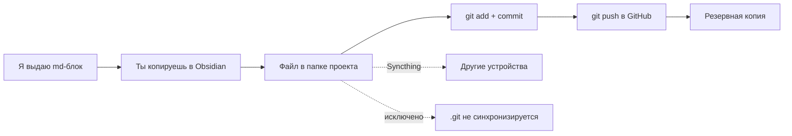

---
title: _Алгоритм_Сохранения
tags: [система, проект, киберзащитник, git, github, алгоритм]
aliases: [Алгоритм_Сохранения, Как_Сохранять_Партии, Git_Флоу]
created: 2026-11-15
date: 2026-11-15
course: Система
---

# Алгоритм сохранения партий «Киберзащитник»

> [!abstract] Кратко
> Проект живёт в папке `~/ObsidianVault/Проекты/Киберзащитник/` внутри личного хранилища. У папки свой `.git`, Syncthing его игнорирует через `.stignore`. Партии сохраняются через Obsidian (`Ctrl+N` → `Ctrl+V` → `Ctrl+S`), затем коммит и push в GitHub через терминал. 30 секунд на партию.

## 1. Зачем это нужно
Проект «Киберзащитник» (148 заметок) должен быть:
1. **Изолирован** от личного хранилища — чтобы публикация базы не тащила за собой ПТСР-дневники, контекст подопечного и прочее личное.
2. **Под контролем версий** — если что-то сломается, `git log` покажет историю и вернёт.
3. **С резервной копией вне ПК** — GitHub хранит копию, если Syncthing сломает хранилище.

Второе хранилище Obsidian (отдельный vault) — рабочий вариант, но у него цена: свои плагины, свои настройки, нет сквозных `[[ ]]`. Вложенный git внутри личного vault даёт изоляцию без этих потерь.

## 2. Простыми словами
- **Личное хранилище** — твой рабочий стол. На нём лежит папка `Проекты/Киберзащитник`.
- **Внутри этой папки** — свой «сейф» (`.git`), который хранит историю изменений.
- **Syncthing** синхронизирует всё, кроме `.git` и `.obsidian` (исключены через `.stignore`).
- **GitHub** — вторая копия сейфа в интернете. Если сгорит ПК, проект выживет.
- **Ты** копируешь мои заметки в папку → делаешь коммит → push → всё сохранено в трёх местах (ПК, Syncthing-устройства, GitHub).

## 3. Технические детали

### 3.1 Структура

```text
~/ObsidianVault/                         ← личное хранилище (Syncthing)
├── .`stignore                            ← исключает .git из синхронизации`
├── Проекты/
│   └── Киберзащитник/                   ← проект (вложенный git)
│       ├── .git/                        ← история (Syncthing игнорирует)
│       ├── .gitignore                   ← что не коммитить
│       ├── README.md
│       ├── _Алгоритм_Сохранения.md      ← эта заметка
│       ├── Киберзащитник_MOC.md
│       ├── 30_01_IT/Сети/               ← атомарные заметки
│       └── Конспекты_занятий_неразобранное/
│           ├── NGFW_UserGate/
│           └── Kaspersky_Endpoint/
```

### 3.2 Что уже сделано (по состоянию на 2026-11-15)

| Шаг                                   | Статус |
| ------------------------------------- | ------ |
| Установлен git 2.47.3                 | ✅      |
| `git config --global user.name`       | ✅      |
| `git config --global user.email`      | ✅      |
| Регистрация на GitHub                 | ⬜      |
| Создан репозиторий `cyber-defender`   | ⬜      |
| SSH-ключ для GitHub                   | ⬜      |
| Папка `Проекты/Киберзащитник` создана | ✅      |
| `.stignore` создан                    | ⬜      |
| `git init` в проекте                  | ⬜      |
| Первый коммит + push                  | ⬜      |
| Партия 1 сохранена                    | ⬜      |

### 3.3 Схема потока



- **Читать схему:** мой md-блок → твой Obsidian → папка проекта → git-коммит → GitHub. Syncthing синхронизирует файлы, но не `.git` (иначе конфликты).

### 3.4 `.stignore` — что исключаем и почему

```text
Проекты/Киберзащитник/.git
Проекты/Киберзащитник/.obsidian/workspace.json
Проекты/Киберзащитник/.obsidian/workspace-mobile.json
Проекты/Киберзащитник/.obsidian/cache
```

**Почему `.git`:** если Syncthing синхронизирует `.git` между устройствами, возникнут конфликты файлов внутри репозитория — `git` не умеет мержить конфликтующие индексы. `.git` живёт **только на одном устройстве** (том, где ты работаешь с проектом).

**Почему `.obsidian/workspace.json`:** это состояние открытых вкладок. На разных устройствах оно разное — смысла синхронизировать нет.

### 3.5 `.gitignore` — что не коммитим

```text
.obsidian/workspace.json
.obsidian/workspace-mobile.json
.obsidian/cache
.obsidian/plugins/*/data.json
.trash/
node_modules/
public/
*.log
.DS_Store
```

**Почему:** это служебные файлы Obsidian и мусор. Плагины ставим заново, если понадобятся. `node_modules/` и `public/` — от Quartz (появятся позже).

## 4. Пример / команда

### 4.1 Первый раз — настройка (один раз в жизни)

**Шаг 1. GitHub (в браузере):**
1. Регистрация: https://github.com/signup
2. **New repository** → имя `cyber-defender` → **Private** (пока не готов публиковать) → **без** README, **без** `.gitignore`.
3. Скопировать SSH-URL: `git@github.com:<user>/cyber-defender.git`

**Шаг 2. SSH-ключ (один раз):**

```bash
ssh-keygen -t ed25519 -C "твой@email"
# Enter, Enter, Enter (без пароля — или с паролем, как решишь)
cat ~/.ssh/id_ed25519.pub
```

Скопировать вывод → GitHub → Settings → **SSH and GPG keys** → New SSH key → вставить.

Проверка: `ssh -T git@github.com` → должно быть `Hi <user>! You've successfully authenticated...`

**Шаг 3. Папка проекта:**

```bash
mkdir -p ~/ObsidianVault/Проекты/Киберзащитник
cd ~/ObsidianVault/Проекты/Киберзащитник
git init
git branch -M main
git remote add origin git@github.com:<user>/cyber-defender.git
```

**Шаг 4. `.stignore` в корне личного хранилища:**

```bash
cat > ~/ObsidianVault/.stignore << 'EOF'
Проекты/Киберзащитник/.git
Проекты/Киберзащитник/.obsidian/workspace.json
Проекты/Киберзащитник/.obsidian/workspace-mobile.json
Проекты/Киберзащитник/.obsidian/cache
EOF
```

Перезапустить Syncthing (или в веб-интерфейсе `http://localhost:8384` нажать «Rescan»).

**Шаг 5. `.gitignore` в проекте:**

```bash
cd ~/ObsidianVault/Проекты/Киберзащитник
cat > .gitignore << 'EOF'
.obsidian/workspace.json
.obsidian/workspace-mobile.json
.obsidian/cache
.obsidian/plugins/*/data.json
.trash/
node_modules/
public/
*.log
.DS_Store
EOF
```

**Шаг 6. Первый коммит:**

```bash
echo "# Киберзащитник" > README.md
git add README.md .gitignore
git commit -m "init: проект Киберзащитник"
git push -u origin main
```

### 4.2 Каждый раз — сохранение партии (30 секунд)

**Шаг 1.** Создать папки, если нужно:

```bash
cd ~/ObsidianVault/Проекты/Киберзащитник
mkdir -p 30_01_IT/Сети
mkdir -p Конспекты_занятий_неразобранное/NGFW_UserGate
mkdir -p Конспекты_занятий_неразобранное/Kaspersky_Endpoint
```

**Шаг 2.** Для каждого файла партии:
- `Ctrl+N` → имя файла (без `.md`, например `SVI`)
- `Ctrl+V` → мой md-блок
- `Ctrl+S`
- В Obsidian `Ctrl+P` → **Move file to...** → выбрать папку (`30_01_IT/Сети/`).

**Шаг 3.** Коммит и push:

```bash
cd ~/ObsidianVault/Проекты/Киберзащитник
git add .
git status                # проверь: 5 новых файлов
git commit -m "партия N: <краткий список>"
git push
```

### 4.3 Проверка после партии

```bash
git log --oneline          # история коммитов
git status                 # должно быть "nothing to commit"
find . -name "*.md" | wc -l # сколько файлов всего
```

**Маркер:** после партии 6 ожидаем 7 коммитов (init + 6 партий) и ~31 md-файл.

## 5. Для ИБ

| Риск | Защита |
|------|--------|
| Случайно закоммитил личное (пароли, `data.json` плагинов) | `.gitignore` исключает `.obsidian/plugins/*/data.json`. Перед первым push проверь `git status` — только `.md`, `.gitignore`, `README.md` |
| Случайно закоммитил `.git` другого проекта (вложенный) | `.gitignore` в проекте не содержит `.git`, но git его и не отслеживает — это служебная папка |
| Syncthing сломал `.git` конфликтами | `.stignore` исключает `.git`. Если всё же сломалось — `git fsck` покажет проблему, восстанови из GitHub (`git clone`) |
| Публичный репозиторий → утечка черновиков | Пока не готов — репозиторий **приватный**. Переключить на публичный после финальной проверки |
| Потеря SSH-ключа → нет push | Ключ хранится в `~/.ssh/id_ed25519`. Бэкап — в менеджере паролей или на флешке. Восстановление — сгенерировать новый, добавить на GitHub |
| Случайный `git push --force` | Не использовать `--force` в `main`. Если что-то не так — `git revert HEAD` (безопаснее) |

## 6. Вопросы для самопроверки
1. Зачем `.stignore` исключает `.git` из Syncthing?
2. Чем `user.name` в git отличается от аккаунта GitHub?
3. Что произойдёт, если сделать коммит без `git config --global user.email`?
4. Зачем нужен SSH-ключ для GitHub?
5. Какие три команды входят в ежедневный ритуал сохранения партии?
6. Что проверять в `git status` перед коммитом?
7. Как восстановить проект, если Syncthing сломал `.git`?

## 7. Частые проблемы и решения

| Проблема | Решение |
|---|---|
| `fatal: not a git repository` | Ты не в папке проекта. `cd ~/ObsidianVault/Проекты/Киберзащитник` |
| `Permission denied (publickey)` при push | SSH-ключ не добавлен на GitHub. `ssh -T git@github.com` → ошибка → пройди шаг 4.1.2 |
| `git push` просит пароль | Используешь HTTPS-URL вместо SSH. `git remote -v` покажет. Замени: `git remote set-url origin git@github.com:<user>/cyber-defender.git` |
| Syncthing создаёт `.git` конфликты | `.stignore` не применился. Проверь `http://localhost:8384` → папка → Ignore patterns → Rescan |
| Obsidian не видит папку `Проекты/Киберзащитник` | Obsidian не показывает пустые папки. Создай первый файл через `Ctrl+N` |
| Случайно закоммитил `.obsidian/` | `git rm -r --cached .obsidian && git commit -m "remove obsidian config" && git push` |
| `git push` отклонён: `non-fast-forward` | Кто-то (или ты с другого устройства) уже запушил. `git pull --rebase`, потом push. Если конфликт — разбирай вручную |
| Хочу работать с проекта на телефоне | Мобильный Obsidian Git не поддерживает вложенные репозитории. Открой `github.com/<user>/cyber-defender` в браузере — читается, но не редактируется |

## 8. Связи
- [[Киберзащитник_MOC]]
- [[MOC_Сети_v3]]
- [[1_MOC_UserGate_NGFW]]
